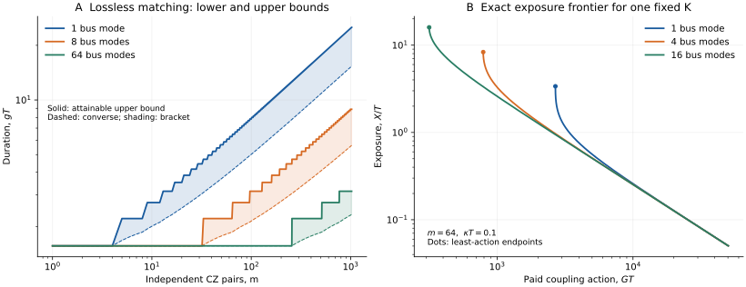

# Quantum Bus Congestion

**How many independent entangling gates can a few harmonic buses perform at fixed drive strength?** This project gives a resource law for parallel CZ matchings synthesized by commuting spin-dependent displacement forces. It accounts for quantum phase equivalence, finite gate accuracy, and the force needed to close a lossy bus trajectory.

There are $`m`$ disjoint qubit pairs and $`b`$ harmonic modes. Each qubit-mode coupling has an independently programmable complex envelope, and every conditional bus trajectory returns exactly to its starting vacuum. With no loss and an instantaneous total squared-coupling budget $`P`$, the optimal duration satisfies

```math
\boxed{\quad P T_{\min}^2=\Theta\!\left(m+\frac{m^2}{b}\right).\quad}
```

Under a fixed individual budget $`\sum_\mu \vert u_{\mu i}(t)\vert ^2\leq g^2`$, this becomes

```math
T_{\min}=\Theta\!\left(g^{-1}\sqrt{1+m/b}\right).
```

Thus constant-duration independent matching requires a number of bus modes proportional to the number of pairs in this model. A collective low-rank phase can have a different cost. The exact gate-level converse permits every equivalent phase representative and every global-phase diagonal completion. Its scaling survives fixed nonzero error under the stated accuracy thresholds.

## Results and where to find them

| Result | Scope and interpretation | Authoritative account |
|---|---|---|
| Exact spectral action for a fixed phase matrix | $`E_{\min}T=2\pi\Phi_b(K)`$; two real directions per bus at each signed temporal harmonic | [Spectral cost](science/spectral_cost.md) |
| Sharp cross-block bound and matching scaling | Converse holds uniformly over all integer phase lifts; explicit closed pulses attain the scaling | [Matching gates](science/matching.md) |
| Approximation-robust gate converse | Boolean phase unwrapping works for unitary half-diamond error below $`1/\sqrt2`$; the direct noisy-channel argument uses the stricter $`1/(2\sqrt2)`$ threshold | [Finite-accuracy proofs](science/matching.md#5-uniform-phase-unwrapping-on-the-boolean-cube) |
| Exact vacuum-loss channel | Retains attenuation and the antisymmetric bath-Gram phase; yields an error floor relative to any unitary target | [Loss and channel error](science/loss_and_frontier.md) |
| Exact paid-action/exposure Pareto frontier | Fixed full $`K`$, fixed time and mode count; includes damping compensation; does not optimize full diamond error | [Exposure frontier](science/loss_and_frontier.md#5-paid-damping-and-the-complete-fixed-k-exposure-frontier) |
| Mode, time, drive and accuracy consequences | Explicit peak-constrained example, modulation and occupation costs, and a mode-independent loss converse | [Architecture](science/architecture.md) |

The analysis uses the weighted spectral control framework of Wong–Baillieul and the Brockett matrix-area program. Geometric-gate loss and compensation also have established precedents. The contribution developed here is the operational connection to the quantum gate's full phase-equivalence class, its stability at fixed accuracy, and the resulting finite-bus resource constraints. The [related-work account](references/related_work.md) separates these ingredients and compares contemporary parallel-gate architectures.

## Read the science

Start with the [science map](science/README.md) and the [model and resource conventions](science/model.md). Follow the [spectral mechanism](science/spectral_cost.md) into the [quantum matching theorem](science/matching.md), then read the [loss/frontier derivation](science/loss_and_frontier.md) and [architectural interpretation](science/architecture.md). The [structured bibliography](references/references.bib) supplies source metadata.



The left panel brackets the lossless optimal duration under individual force caps. The right panel shows exact action/exposure frontiers for the same prescribed phase matrix, without a pointwise force cap. These are different optimization problems; the [figure explanation](science/architecture.md#3-two-resource-comparisons) states their parameters and assumptions.

## Learn the argument

The learning route uses one educational anchor: **Häffner, Roos and Blatt, “Quantum computing with trapped ions” (2008)**, with section pointers to the open [arXiv:0809.4368v1](https://arxiv.org/abs/0809.4368v1) version. Start at the [learning guide](learning/README.md). The [Häffner–Roos–Blatt bridge](learning/HAEFFNER_BRIDGE.md) connects the review's spin–motion physics and geometric gates to this project's conventions, gives a fully costed single-CZ example, and identifies the mathematical additions and limits of the physical analogy.

The shared [30-milestone map](learning/MILESTONES.md) contains 13 background milestones and 17 milestones through the scientific argument. Both phases move from local mechanisms to the complete system. Each milestone states a central question, its understanding target, earlier dependencies and source pointers. The route is an entry into the authoritative science pages above.

## Reproduce the finite checks

With Python 3.11 or later, from the repository root:

```bash
python3 -m pip install -r verification/requirements.txt
python3 verification/run_all.py
```

The checks integrate the explicit matching pulses, reconstruct general phase matrices from the spectral controls, independently approximate the area-operator spectrum, and compare the exact channel with direct finite-oscillator Lindblad evolution. They also regenerate the resource figure and numerical example. The [verification guide](verification/README.md) gives tolerances, observed results and limits. General converses and asymptotic laws are established by the written proofs.

## Consequential scope

The control axis stays fixed during the force interval. Exact conditional closure, independently programmable complex couplings, and an ideal harmonic ladder are part of the result. Squeezing, nonlinear or encoded buses, noncommuting intermediate spin control, extra coherent ancillas, measurements and feedback, residual bus entanglement, finite occupation ceilings, and strict bandwidth limits require separate models.

The quantity $`G=\int\sum_{\mu i}\vert u_{\mu i}\vert ^2dt`$ is squared-coupling action, not energy in joules. Loss claims use vacuum Markov damping with a common mode loss rate. They do not model every experimental heating mechanism. Global gate error, local noise suitable for fault tolerance, and exposure are distinct quantities. No full noisy-gate optimum or fault-tolerance threshold is claimed.

## Purpose and contact

This repository serves as a record of the work and a guide for the author’s self-directed learning. For discussion or potential collaboration, please contact Ruge Lin at [gogoko699@gmail.com](mailto:gogoko699@gmail.com).
